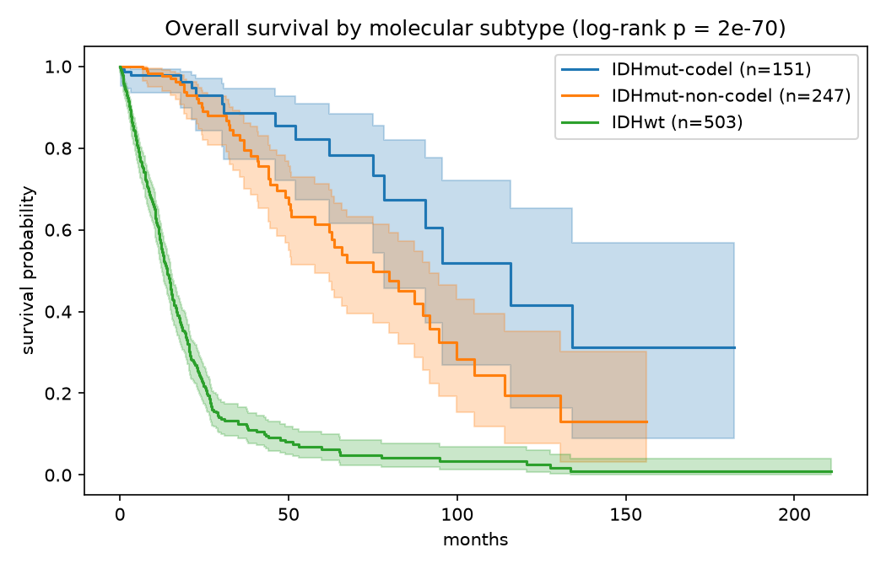
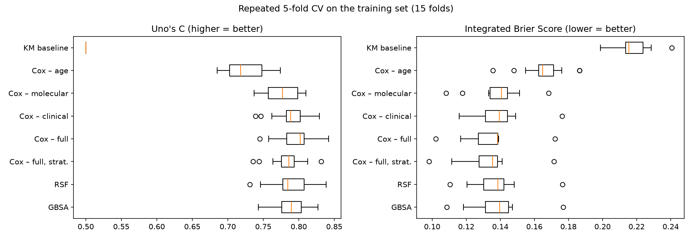
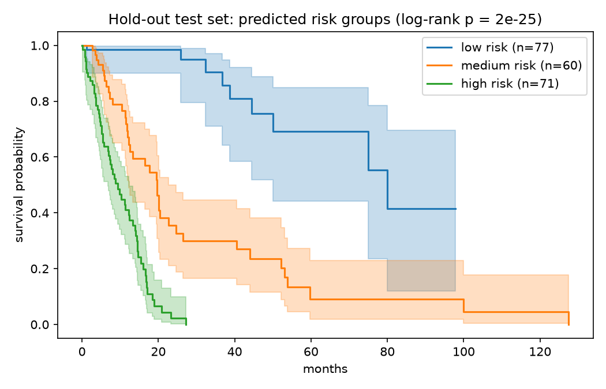
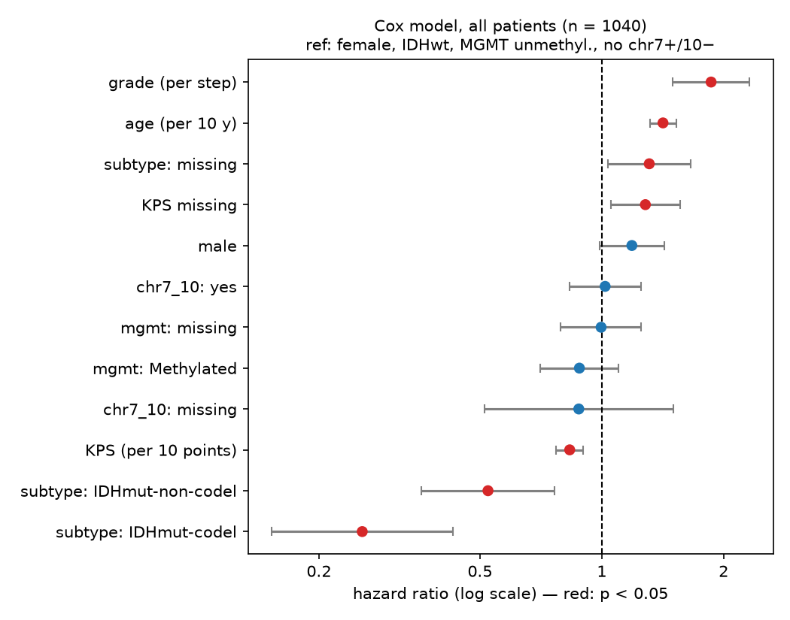
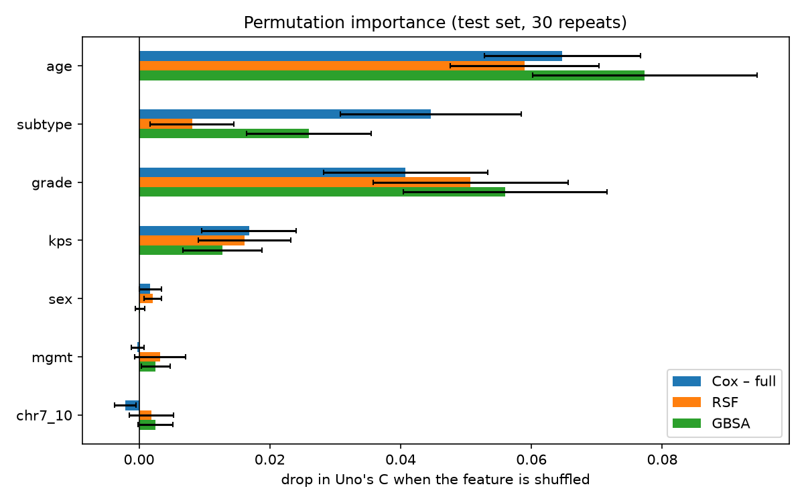

# Survival Prediction in Diffuse Glioma (TCGA LGG + GBM)

## Summary
In 1040 TCGA diffuse glioma patients, a Cox model with 7 routinely available clinical and molecular features
predicts overall survival with a **Uno's C-index of 0.81** and an **integrated Brier score of 0.118** on a held-out
test set (no-information baseline: 0.220). Random Survival Forest and Gradient Boosting Survival did not beat it.
Under nested cross-validation, Cox was better in 11–14 of 15 paired folds. The prognostic signal is dominated by
**age, tumour grade, IDH/1p19q subtype and Karnofsky score**. MGMT methylation and chr7+/10− added no information
once these were known.

## 1. Data
* **Source:** cBioPortal study `lgggbm_tcga_pub` (Ceccarelli et al., *Cell* 2016), grade 2–4 diffuse gliomas.
* **Endpoint:** overall survival (months), right-censored.
* **Cohort after cleaning:** 1040 patients (patients without OS or with zero follow-up were removed), **524 deaths**,
  516 censored. Median follow-up time is 11.8 months, and only 66 patients remain at risk at 5 years.
* **Features:** age, sex, Karnofsky performance score (KPS), WHO grade, IDH/1p19q subtype, MGMT promoter status,
  combined chr7 gain/chr10 loss.
* **Missing data:** KPS 33%, MGMT 18%, subtype 13%. Values were imputed *inside* each CV fold (median plus a
  missing-flag for numerics, an explicit "missing" category for categoricals), so all patients are used and
  nothing leaks from the validation folds.



| subtype | n | median OS | 5-year OS |
|---|---|---|---|
| IDH-mutant, 1p/19q-codeleted | 151 | ~116 months | 82% |
| IDH-mutant, non-codeleted | 247 | ~75 months | 61% |
| IDH-wildtype | 503 | **14 months** | 6% |

## 2. Methods
* **Validation design:** a fixed 20% hold-out test set (208 patients, stratified on the event) was used once, at
  the end. Models were compared with repeated stratified 5-fold CV (5×3 = 15 folds) on the remaining 832 patients.
  The tree models used **nested CV**: hyperparameters were tuned by a 3-fold grid search inside each outer fold.
* **Metrics:**
  * Harrell's C and **Uno's C** (IPCW, truncated at 36 months)
  * time-dependent AUC at 6, 12, 24 and 36 months
  * **integrated Brier score (IBS)**

  Evaluation stops at 36 months because follow-up beyond that is too sparse.
* **Models:**
  * Kaplan-Meier baseline (no features)
  * nested Cox models: age; clinical; molecular; full; full stratified by subtype (ridge-penalised)
  * Random Survival Forest
  * Gradient Boosting Survival Analysis (Cox loss)

## 3. Results



| model | Uno's C (CV) | mean AUC (CV) | IBS (CV) | Uno's C (test) | IBS (test) |
|---|---|---|---|---|---|
| KM baseline | 0.500 | 0.500 | 0.218 | 0.500 | 0.220 |
| Cox – age only | 0.725 ± 0.029 | 0.796 | 0.166 | 0.753 | 0.156 |
| Cox – molecular | 0.778 ± 0.024 | 0.841 | 0.139 | | |
| Cox – clinical | 0.788 ± 0.025 | 0.852 | 0.139 | | |
| **Cox – full** | **0.795 ± 0.026** | **0.859** | **0.134** | **0.813** | **0.118** |
| Cox – full, stratified | 0.783 ± 0.024 | 0.849 | 0.133 | | |
| Random Survival Forest | 0.790 ± 0.029 | 0.853 | 0.137 | 0.811 | 0.120 |
| Gradient Boosting | 0.789 ± 0.024 | 0.853 | 0.139 | 0.805 | 0.125 |

* **Age alone** is already a strong predictor (C ≈ 0.73).
* The **clinical** block (grade, KPS) and the **molecular** block (IDH/1p19q) each add about 0.05–0.06.
  Together they add only about 0.01 more, because grade and IDH status largely carry the same information.
* **The tree ensembles did not beat Cox**, even with widened hyperparameter grids. Gradient boosting preferred
  depth-1 trees, which form an additive model with no interactions. This suggests the signal in these features is
  mostly additive and close to log-linear.
* On the test set, the three risk groups (cut-offs taken from the training set) separate clearly (log-rank p ≈ 1e-25).
  Calibration is good at 12 months and acceptable at 24 months.



### Interpretation



These hazard ratios come from the Cox model fitted on all 1040 patients:

| factor | HR (95% CI) |
|---|---|
| IDH-mutant, 1p/19q-codeleted (vs IDHwt) | **0.26** (0.15–0.43) |
| IDH-mutant, non-codeleted (vs IDHwt) | **0.52** (0.36–0.76) |
| grade, per step | **1.86** (1.50–2.31) |
| age, per 10 years | **1.42** (1.31–1.53) |
| KPS, per 10 points | **0.83** (0.77–0.90) |
| subtype missing / KPS missing | 1.31 / 1.28 (both p < 0.05) |
| MGMT methylated | 0.88 (0.71–1.10), n.s. |
| chr7+/10− | 1.02 (0.83–1.25), n.s. |



Cox, RSF and GBSA agree on the top four features: **age > grade ≈ subtype > KPS**. Grade and subtype are strongly
correlated (almost every IDH-wildtype tumour is grade 4). The models therefore split the credit between them
differently: RSF leans on grade, Cox on subtype.

## 4. Limitations
* **Short follow-up:** the median is about 12 months. Long-term survival of IDH-mutant patients, especially
  beyond 3 years, is poorly estimated.
* **No treatment data:** extent of resection, radiotherapy and temozolomide are missing. MGMT methylation
  predicts response to temozolomide, so its value cannot show up without treatment information.
* **The proportional-hazards assumption is violated** for age and chr7/10, as Schoenfeld residuals show.
  Stratifying by subtype fixed the subtype violation but did not improve prediction. The hazard ratios above are
  best read as time-averaged effects.
* **Informative missingness:** patients with missing molecular data or KPS do worse. This most likely reflects
  differences between collection sites rather than biology.
* **Single cohort:** there is no external validation (for example on CGGA or a clinical cohort).
* **The WHO 2016 histology–grade framework** is used here. Under WHO 2021, IDH-wildtype grade 2–3 astrocytomas with
  GBM molecular features would be reclassified as grade 4 glioblastoma.

## 5. Next steps
* **Imaging features.** Use the tumour segmentations from the UNET project (`../C1`): tumour volume, enhancing and
  necrotic fractions, and radiomics. Add them to the clinical model, and test whether DeepSurv helps in that
  higher-dimensional setting. This needs a dataset with both MRI and survival data, such as BraTS 2020, or
  TCGA-GBM/LGG on TCIA, which can be linked to this cohort by patient ID.
* **External validation** on CGGA.

## Reproduce
```bash
python3.11 -m venv .venv && .venv/bin/pip install -r requirements.txt
.venv/bin/python src/prepare_data.py
# then run notebooks/02 → 03 → 04 → 06 with the "Glioma Survival (.venv)" kernel
```
